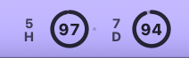

# Codex Usage Status

An independent macOS menu-bar companion for showing Codex usage at a glance.



This repository is an independent continuation based on [tollenceld/codex-usage-status](https://github.com/tollenceld/codex-usage-status), originally created by [@tollenceld](https://github.com/tollenceld). The original project and its MIT license remain credited; this repository is maintained independently.

## Current design

The menu-bar badge uses a compact side-labeled double-ring layout:

- left ring group: 5-hour remaining percentage (`5H`)
- right ring group: weekly / 7-day remaining percentage (`7D`)
- ring progress: remaining quota status
- ring center number: remaining percentage
- no capsule background, so it stays visually lightweight beside the other macOS status items

The normal badge uses macOS's native menu-bar template tinting. This lets the icon follow the surrounding status-bar contrast automatically instead of forcing a fixed light/dark color. When either remaining value falls below 20%, that window turns system red as an actionable warning; normal values remain neutral.

The menu-bar badge is the primary interface. Clicking it exposes only the necessary actions: Refresh, Display Style, Settings, and Quit.

The repository also ships the selected 1B-M app icon in the bundle. It is intentionally separate from the live menu-bar badge: the app icon is a stable brand mark, while the menu-bar image remains a native template image that follows macOS status-bar contrast and carries the live 5H/7D readings. See [branding/README.md](branding/README.md) for the measured SVG source and icon validation.

Double Ring is the default display style. A larger accessibility-oriented style is available from Display Style > Large Readout. Large Readout keeps both values visible while prioritizing larger readable numbers with weak `5H` / `7D` labels and thin status lines.

## Adaptive refresh

The app uses a conservative adaptive schedule so active usage is detected quickly without polling continuously:

- startup and activity: refresh every 30 seconds; any valid raw usage change or detected window cycle rebuilds the activity baseline
- quiet for 90 seconds: refresh every 60 seconds
- quiet for 5 minutes: refresh every 120 seconds; normal adaptive polling stops backing off here
- failed request: retry after 300 seconds
- manual refresh: always available from the menu

Automatic queries are spaced at least 30 seconds apart. A finite `CODEX_USAGE_REFRESH_SECONDS` value explicitly selects a fixed success cadence instead of adaptive polling, with a 30-second minimum. Failed requests still retry after 300 seconds. Timer tolerance and request duration mean these intervals are not exact end-to-end update guarantees.

## Sleep, wake, and last-known readings

The app keeps the last successful snapshot in memory. A temporary refresh failure no longer replaces valid numbers with an error-only badge: a neutral `~` separator marks last-known readings, and the tooltip shows the last successful read and latest error. Successful reads replace the snapshot and clear the error.

On device wake or display wake, the app redraws immediately and schedules a coalesced refresh, respecting the automatic minimum interval. Network recovery can advance a later retry. Sleep-era responses are discarded, and multiple wake/display events do not create parallel requests. While sleeping, query and display-expiry timers are stopped.

Each window becomes unknown at its own known reset deadline; a local one-shot redraw hides it without an extra quota query. Last-known data has a 24-hour display-retention ceiling and is always labelled stale after wake or failure. This ceiling is not a freshness guarantee. Restarting the process clears the in-memory snapshot: disk quota caching is deliberately not enabled because the rate-limit response does not identify which account a saved snapshot belongs to.

The reproducible UI integration check uses fake responses and process-local workspace notifications, without putting the Mac to sleep or accessing an account:

```sh
bash scripts/test-wake-recovery.sh
```

See [wake/cache analysis](docs/wake-cache-strategy.md) for persistence tradeoffs and verification limits.

## Safety model

This app only calls the official local Codex app-server method `account/rateLimits/read`. It does not modify Codex, does not read `~/.codex/auth.json`, and does not handle tokens, cookies, sessions, OAuth credentials, API keys, or browser data.

See [PRIVACY.md](PRIVACY.md) for the user-facing privacy summary and [SECURITY.md](SECURITY.md) for the hard engineering boundaries.

## Requirements

- macOS 13 or later
- Codex desktop installed and already signed in
- The app automatically checks the common Codex desktop layouts in `/Applications` and `~/Applications`, including `Codex.app` and `ChatGPT.app`; `CODEX_BIN` remains available for a custom development install

## Install from release

1. Download the latest release ZIP for your Mac from [GitHub Releases](https://github.com/TrevorLt/codex-usage-status/releases):
   - Apple Silicon: `CodexUsageStatus-<version>-macos-arm64.zip`
   - Intel: `CodexUsageStatus-<version>-macos-x86_64.zip`
2. Unzip it.
3. Move `CodexUsageStatus.app` to `/Applications`.
4. Open `CodexUsageStatus.app`.

You can also download the matching DMG for a standard macOS drag-to-install experience. Open the DMG and drag `CodexUsageStatus.app` onto the `Applications` shortcut. The DMG uses the same 1B-M app icon and a lightweight charcoal/lavender installation layout; it does not install background helpers or change unrelated system settings.

The app is menu-bar-only, so it does not appear in the Dock. The bundle includes the 1B-M `CodexUsageStatus.icns` app icon. To launch it automatically after login, add `CodexUsageStatus.app` in macOS System Settings > General > Login Items, or manage it with a per-user LaunchAgent if you are maintaining a developer installation.

On its first refresh, the app automatically checks the legacy Codex layout, the current ChatGPT-bundled Codex CLI shim, the nested Codex app-server executable, and per-user `/Applications` locations. If none is executable, hover the red `?` badge or open Settings to see the checked locations and the next action.

Unsigned GitHub builds may trigger macOS Gatekeeper warnings. For a public polished release, sign with an Apple Developer ID and notarize the app.

## Known limitations

- A custom Codex installation outside the known `/Applications` and `~/Applications` layouts requires `CODEX_BIN` for a source/developer launch.
- You must already be signed in to Codex.
- Live usage depends on Codex's local app-server method `account/rateLimits/read`; if that local interface changes, this app may need an update.
- The app shows usage only. It cannot buy credits, switch accounts, retry login, or change limits.
- Local builds are ad-hoc signed by default. Downloaded release ZIPs may show Gatekeeper warnings until a notarized build is available.

For a failure matrix and diagnostic interpretation, see [docs/diagnostics.md](docs/diagnostics.md).

## Build from source

For source builds:

- Swift toolchain / Xcode Command Line Tools
- Node.js 20 or later for tests and the optional CLI probe

```sh
npm test
bash scripts/test-wake-recovery.sh
node branding/verify-logo.mjs
npm run build:macos
npm run start:macos
```

The build embeds the tracked `branding/CodexUsageStatus.icns` file in `Contents/Resources` and declares it in the generated `Info.plist`. The wake/recovery integration check uses fake responses and never reads an account. The logo verification renders the four source variants and checks their measured geometry.

The build script defaults to the Mac's hardware architecture. On Apple Silicon this creates an `arm64` app, even if Node.js is running under Rosetta. To build a specific architecture:

```sh
BUILD_ARCH=arm64 npm run build:macos
BUILD_ARCH=x86_64 npm run build:macos
```

To install into `/Applications`:

```sh
npm run install:macos
```

The app is a menu-bar-only app, so it does not appear in the Dock.

To change the menu-bar display, click the badge and choose Display Style:

- Double Ring: compact default with side labels and circular quota indicators.
- Large Readout: larger numbers with subtle status lines for easier reading.

To select an explicit fixed success interval while keeping the 30-second minimum:

```sh
CODEX_USAGE_REFRESH_SECONDS=180 npm run start:macos
```

## CLI probe

The CLI uses the same safe app-server source and is useful for debugging:

```sh
npm run usage
npm run usage:json
```

The CLI output remains text-based for logs and tests even though the macOS menu-bar UI is a graphic badge.

If your Codex binary lives somewhere else:

```sh
CODEX_BIN=/path/to/codex npm run usage
```

## Release package

```sh
npm run package:macos
npm run package:macos:all
```

`package:macos` creates an architecture-specific ZIP and DMG for the current Mac. `package:macos:all` creates both `arm64` and `x86_64` ZIPs and DMGs plus `SHA256SUMS.txt` in `dist/`.

Release ZIPs are architecture-specific:

- `CodexUsageStatus-<version>-macos-arm64.zip` for Apple Silicon Macs.
- `CodexUsageStatus-<version>-macos-x86_64.zip` for Intel Macs.
- `CodexUsageStatus-<version>-macos-arm64.dmg` for Apple Silicon Macs.
- `CodexUsageStatus-<version>-macos-x86_64.dmg` for Intel Macs.

Each release ZIP and DMG contains the same 1B-M app icon; only the executable architecture differs.

For another MacBook, the most reliable source-build path is to clone the repository on that Mac and run `npm run install:macos`; it will build the correct native architecture there.

## Repository layout

- `macos/CodexUsageStatus/`: native AppKit menu-bar app.
  - `App/`: status item lifecycle, menu actions, refresh scheduling, and configuration.
  - `Codex/`: local Codex app-server JSON-RPC client.
  - `Domain/`: rate-limit response models and usage normalization.
  - `UI/`: badge styles and AppKit drawing code.
- `src/`: Node CLI probe for diagnostics and tests.
- `test/`: Node tests for response normalization and sensitive-output redaction.
- `scripts/`: build, run, install, and release packaging scripts.
- `.github/workflows/`: CI and release artifact workflows.
- `docs/`: architecture, structure, release, and upstream integration notes.

See [docs/project-structure.md](docs/project-structure.md) for the source layout and dependency boundaries.
