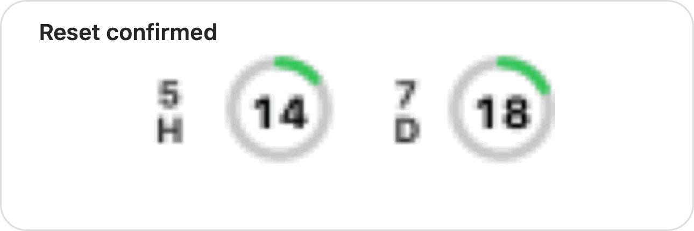
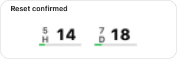
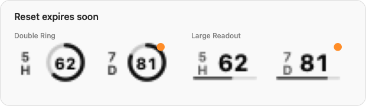

# Codex Usage Status

[](https://github.com/TrevorLt/codex-usage-status/actions/workflows/ci.yml)
[](https://github.com/TrevorLt/codex-usage-status/releases/latest)
[](LICENSE)

A small macOS menu-bar companion for seeing Codex 5-hour and weekly usage, with an optional, explicitly confirmed action to use an earned reset.

| **Double Ring** (default) | **Large Readout** |
|:---:|:---:|
|  |  |

Switch between the two modes from the badge's **Display Style** menu.

The 5-hour and 7-day readings animate smoothly when refreshed. A confirmed reset briefly highlights only the recovered window in green in both display modes.

| **Double Ring reset animation** | **Large Readout reset animation** |
|:---:|:---:|
|  |  |

Reset animations loop continuously with a 1.5-second pause between cycles.

An amber dot marks an earned reset that expires within 72 hours. It stays on the badge as a quiet reminder; the menu offers a direct path to use the earliest known-expiring reset.



This repository is an independent continuation based on [tollenceld/codex-usage-status](https://github.com/tollenceld/codex-usage-status), originally created by [@tollenceld](https://github.com/tollenceld). The original project and its MIT license remain credited; this repository is maintained independently.

## At a glance

| | Details |
| --- | --- |
| Platform | macOS 13 or later |
| Architectures | Apple Silicon (`arm64`) and Intel (`x86_64`) |
| Data source | The official local Codex app-server |
| Protocol | Reads `account/rateLimits/read`; uses a reset only after confirmation |
| Automatic refresh | Adaptive 30 / 60 / 120 seconds |
| Failure retry | 300 seconds |
| Published release | [`v0.1.4`](https://github.com/TrevorLt/codex-usage-status/releases/tag/v0.1.4) |
| License | [MIT](LICENSE) |

## What it does

- Shows 5-hour (`5H`) and weekly / 7-day (`7D`) remaining percentages in the menu bar.
- Uses macOS template tinting so neutral content follows the surrounding status-bar contrast.
- Turns only the low-usage ring or readout bar red below 20%; the percentage text remains readable.
- Marks last-known readings with a neutral `~` directly beside each cached percentage.
- Refreshes adaptively while keeping a hard 30-second minimum between automatic requests.
- Recovers after sleep, display wake, and network recovery without duplicating requests.
- Provides a checkable Launch at Login menu item and a live `Next refresh` countdown in About.
- Shows a compact badge reminder when an earned reset expires within 72 hours; the menu can jump to the earliest known expiry, confirm its use, or dismiss that reminder batch.
- Shows each earned reset's known expiration in About and formats About timestamps consistently in the current local time zone.
- Smoothly animates quota changes and confirms reset recovery with a brief green progress animation in both display modes.
- Includes a branded app icon and Retina-ready DMG packaging.

The app is a usage monitor, not an account manager. It cannot log in, switch accounts, change limits, buy credits, or bypass usage limits. It can consume one earned reset only after you choose **Use reset** and confirm.

## Download and install

The latest published release is [`v0.1.4`](https://github.com/TrevorLt/codex-usage-status/releases/tag/v0.1.4). Download the artifact matching your Mac:

- Apple Silicon: `CodexUsageStatus-0.1.4-macos-arm64.dmg` or `.zip`
- Intel: `CodexUsageStatus-0.1.4-macos-x86_64.dmg` or `.zip`

### DMG

1. Open the architecture-matched DMG.
2. Drag `Codex Usage Status` to the `Applications` shortcut.
3. Open `Codex Usage Status.app`.
4. Click the menu-bar badge and enable `Launch at Login` if desired.

### ZIP

1. Download and unzip the architecture-matched ZIP.
2. Move `Codex Usage Status.app` to `/Applications`.
3. Open the app.
4. Click the menu-bar badge and enable `Launch at Login` if desired.

The app is menu-bar-only and does not appear in the Dock. The DMG uses the project icon as its volume icon and includes a Retina-ready background. Downloaded unsigned or ad-hoc-signed builds may require normal macOS Gatekeeper approval.

## Menu-bar controls

Click the badge to access:

- `Refresh` — request an immediate update, subject to the safety floor.
- `Use one reset…` — choose **Use reset** to consume a specific credit returned for the current account, preferring the earliest known expiry. If Codex provides no credit ID, use the reset in Codex instead.
- `Check previous reset…` — retry an uncertain reset for the same account, even when no credits remain. A confirmed redemption needs only a usage refresh if its follow-up read fails.
- `Display Style` — choose `Double Ring` or `Large Readout`.
- `Launch at Login` — enable or disable the per-user LaunchAgent.
- `About` — inspect usage, reset times, app version, executable path, and refresh state. While About is open, `Next refresh` updates once per second without issuing additional usage requests.
- `Quit` — stop the monitor for this session while preserving Launch at Login for your next login.

`Double Ring` is the default compact style. `Large Readout` keeps both values visible with larger numbers and thin status lines.

## Refresh and stale readings

The normal adaptive schedule is deliberately conservative:

- 30 seconds during startup and detected activity;
- 60 seconds after 90 seconds without a valid usage change;
- 120 seconds after 5 minutes without a valid usage change;
- 300 seconds after a failed request;
- manual refresh remains available from the menu.

These are scheduling targets, not exact end-to-end freshness guarantees: timer tolerance and request duration can add delay. Automatic requests never start more often than every 30 seconds.

The app keeps the last successful snapshot in process memory while it revalidates. A temporary failure does not replace valid numbers with an error badge. A neutral `~` prefix beside each cached percentage means the reading is provisional; the tooltip and About panel show the last successful read and the latest error. Successful data clears the stale state. The two readings have no center separator dot in either display mode.

After sleep or display wake, the app redraws immediately and schedules one coalesced recovery refresh. Each window is hidden after its own known reset time without an extra account request. Cached readings expire from display after 24 hours. Disk quota caching is intentionally not enabled because the local response does not safely identify an account.

See [the wake/cache analysis](docs/wake-cache-strategy.md) and [the refresh research](docs/refresh-scheduling-research.md) for the design tradeoffs and evidence boundaries.

## Troubleshooting

If the badge shows `?`, hover it or open `About` first; the app reports a safe failure category without exposing raw authentication material. The [failure matrix](docs/diagnostics.md) covers missing Codex executables, sign-in state, unsupported app-server responses, architecture mismatches, Gatekeeper blocks, sleep/wake failures, and hidden menu-bar items.

## Privacy and security

The app is intentionally narrow:

- It reads usage through the local Codex app-server method `account/rateLimits/read`.
- It calls `account/rateLimitResetCredit/consume` only after you explicitly confirm **Use reset**. A pending idempotency key and selected opaque credit ID may be kept locally until the result is confirmed, to prevent a retry from consuming another reset.
- Saved reset requests include a hashed account identifier and a specific credit ID. Requests without either binding cannot be retried here; check their status in Codex before explicitly clearing them.
- It does not read `~/.codex/auth.json`.
- It does not read or store tokens, cookies, sessions, OAuth credentials, refresh tokens, API keys, passwords, browser storage, or chat history.
- It does not scrape Codex or browser pages, use screenshots/OCR, automate login, or modify the official Codex app.
- It does not upload usage data to this project or a third-party service.

Codex owns authentication and any backend communication. This companion receives only the structured rate-limit response returned through the local app-server. See [PRIVACY.md](PRIVACY.md) and [SECURITY.md](SECURITY.md).

## Requirements

- macOS 13 or later;
- Codex desktop installed and already signed in;
- Node.js 20 or later for tests and optional CLI development commands;
- Swift toolchain / Xcode Command Line Tools for source builds.

The app checks common `Codex.app` and `ChatGPT.app` layouts in `/Applications` and `~/Applications`. A custom development installation can be selected with `CODEX_BIN`.

## Build and run from source

```sh
git clone https://github.com/TrevorLt/codex-usage-status.git
cd codex-usage-status
npm test
npm run build:macos
npm run start:macos
```

Development startup unloads the existing login task for this session, stops known app copies, and verifies that the workspace executable is running. The saved login configuration is preserved; a failed launch restores the previous login task.

To install the source build into `/Applications` using the guarded migration script:

```sh
npm run install:macos
```

The build defaults to the Mac's hardware architecture. To select one explicitly:

```sh
BUILD_ARCH=arm64 npm run build:macos
BUILD_ARCH=x86_64 npm run build:macos
env -u BUILD_ARCH npm run build:macos  # restore the hardware-native build before running it
```

For a one-shot local usage probe, use the built executable:

```sh
dist/'Codex Usage Status.app'/Contents/MacOS/CodexUsageStatus --once
```

## Test and verification

The supported checks are:

```sh
npm test
npm run test:native
npm run test:swiftpm       # when the selected toolchain includes XCTest
BUILD_ARCH=arm64 npm run build:macos
BUILD_ARCH=x86_64 npm run build:macos
env -u BUILD_ARCH npm run build:macos  # restore the hardware-native build before running it
```

`npm run test:native` covers policy/domain behavior, executable discovery, subprocess faults, installer migration, LaunchAgent handling, sleep/wake recovery, and AppKit badge rendering. Its GUI harnesses require a logged-in macOS graphical session; a GUI process that exits without its explicit PASS marker is treated as a failure.

`npm run test:badge-animation` checks animation frames without AppKit or real-time waits. `npm run test:reset-flow` exercises reset success, fresh reads, unchanged windows, and failure paths against a fake client; it never calls the account reset endpoint. The native suite also checks rendered reset highlights, stale-number layout, and exact About expiry lines.

To inspect frames manually, run `npm run preview:badge-animations`. The standalone preview window shows both display styles in light and dark appearances. Select a normal refresh, confirmed 5h/7-day reset, unchanged reset result, reset-expiry reminder, or last-known state, then drag the timeline or press Play. It uses synthetic local values and cannot redeem a real reset.

For release artifacts, the repository also verifies app identity, architecture, code-signing structure, icon embedding, DMG contents, and SHA-256 checksums. See [the release checklist](docs/release-checklist.md).

## Packaging and releases

Packaging is separate from development installation:

```sh
npm run package:macos       # current hardware architecture
npm run package:macos:all   # arm64 and x86_64 artifacts
npm run package:macos:dmg  # DMG for the selected architecture
```

Generated artifacts include the app bundle, architecture-specific ZIP/DMG files, and `SHA256SUMS.txt`. Public releases should use Apple Developer ID signing and notarization; local builds are ad-hoc signed by default. Notarization is not automated because it requires Apple developer credentials.

Release process and artifact checks are documented in [docs/release.md](docs/release.md), and version-specific download guides live in the release notes.

## Repository layout

```text
src/                         optional Node CLI and protocol probe
macos/CodexUsageStatus/      Swift/AppKit menu-bar app and native tests
branding/                    icon, SVG source, and geometry checks
scripts/                     build, install, package, and integration checks
docs/                        architecture, research, diagnostics, and release notes
CONTRIBUTING.md              contribution boundaries and local checks
PRIVACY.md                   user-facing privacy summary
SECURITY.md                  security boundaries and reporting policy
```

## Contributing

Please read [CONTRIBUTING.md](CONTRIBUTING.md) before opening a change. Keep the project narrow and safe: do not add credential-file access, browser scraping, login automation, quota-bypass behavior, or aggressive polling. Changes that alter refresh behavior should include measured freshness/resource evidence and updated tests or documentation.

For bugs, include the macOS version, hardware architecture, app version, display style, a minimal reproduction, and redacted diagnostics. Never attach tokens, cookies, `~/.codex/auth.json`, raw authentication material, or private account data. Security issues should follow [SECURITY.md](SECURITY.md), not a public issue.

## Attribution and license

This independent continuation is based on [tollenceld/codex-usage-status](https://github.com/tollenceld/codex-usage-status) by [@tollenceld](https://github.com/tollenceld). The project is released under the [MIT License](LICENSE).
